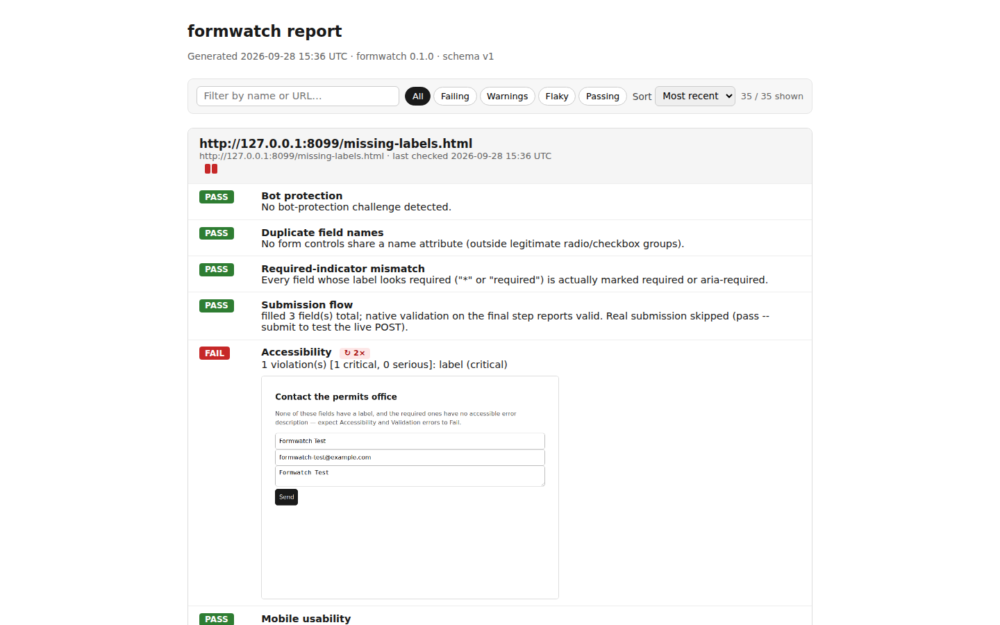
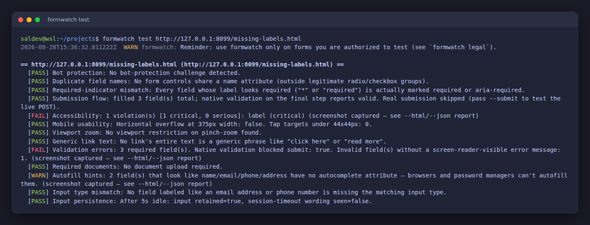
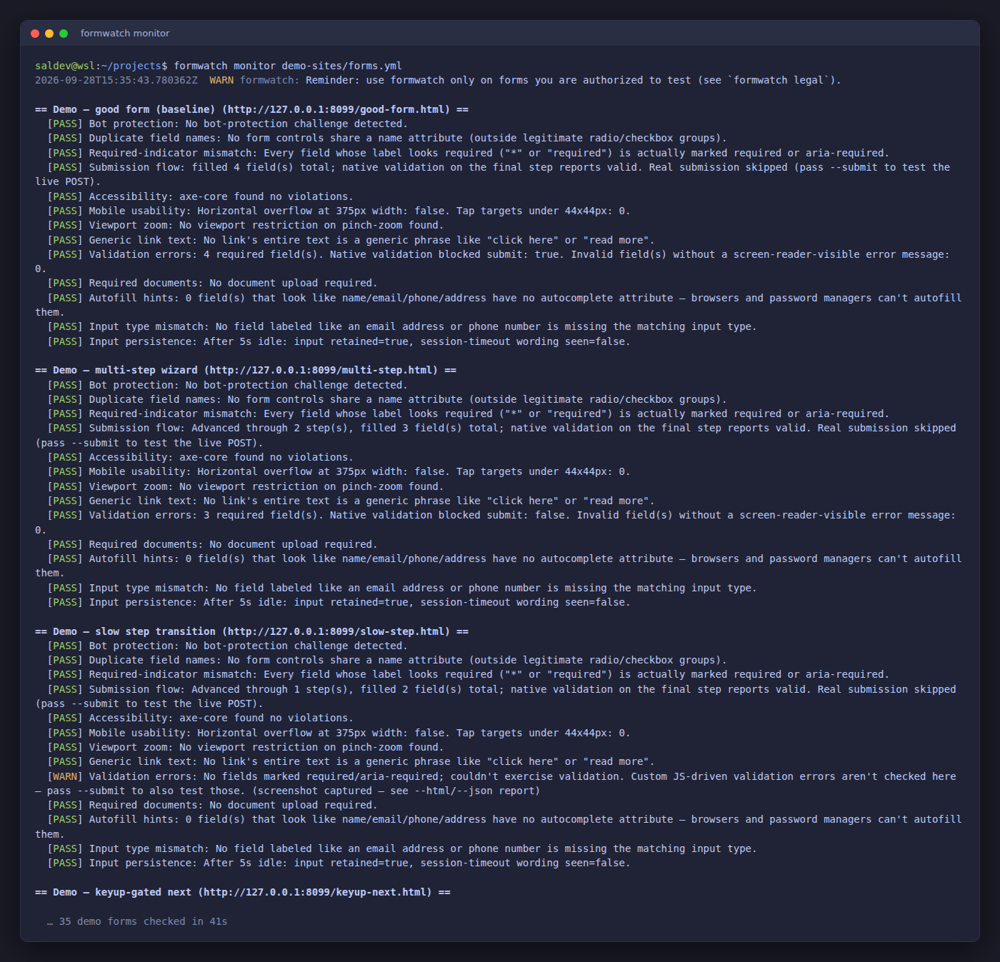

# formwatch

[](https://github.com/voidstackloop/formwatch/actions/workflows/ci.yml)

A CLI that tests public-service forms (permit applications, benefits forms,
license renewals) for the things that quietly break them: broken submission
flows, inaccessible markup, unusable mobile layouts, lost input, and unclear
validation errors.

```
formwatch init
formwatch test https://city.gov/apply
formwatch monitor forms.yml
formwatch report --html
```



<details>
<summary>More screenshots and diagrams</summary>





More in [docs/diagrams.md](docs/diagrams.md).
</details>

## Install

Prebuilt binaries for Linux (x86_64), macOS (Intel and Apple Silicon) and
Windows are attached to each [GitHub release](https://github.com/voidstackloop/formwatch/releases/latest),
along with a `SHA256SUMS.txt`. On Linux:

```sh
curl -sSL https://github.com/voidstackloop/formwatch/releases/latest/download/formwatch-x86_64-unknown-linux-gnu.tar.gz | tar xz
sudo mv formwatch-x86_64-unknown-linux-gnu/formwatch /usr/local/bin/
formwatch --version
```

Or build from source with Rust 1.88 or newer:

```sh
cargo install --git https://github.com/voidstackloop/formwatch --locked
```

formwatch needs Chrome or Chromium; if neither is on `PATH`, it downloads a
headless build on first run (see [Requirements](#requirements)).

See [CHANGELOG.md](CHANGELOG.md) for what's shipped so far, and
[docs/adr/0001-formwatch-architecture.md](docs/adr/0001-formwatch-architecture.md)
for why it's built the way it is.

## Legal & authorized use — read this first

formwatch drives an automated browser against live third-party websites
and, with `--submit`, performs a real HTTP POST. **Only point it at forms
you own or have explicit written permission to test.** Running it against
a system you are not authorized to test may be unlawful (e.g. the U.S.
Computer Fraud and Abuse Act, the U.K. Computer Misuse Act) and will
almost certainly violate that site's terms of service.

- `--submit` is refused until you acknowledge the notice, via
  `--accept-terms` or `FORMWATCH_ACCEPT_TERMS=1`.
- Never use formwatch for denial-of-service, credential attacks,
  scraping, or to bypass authentication/CAPTCHAs/rate limits.
- Respect `robots.txt` and terms of service; use `--delay-ms` and
  `--per-host-delay-ms` against third-party hosts.
- Screenshots can contain personal data — disable them with
  `--no-screenshots` where that matters.

Run `formwatch legal` for the built-in notice, and see
[docs/legal.md](docs/legal.md) for the full text. You are responsible for
your own use.

## What it checks

- **Page load** — if the form doesn't load at all (unreachable, DNS
  failure, connection refused), that's reported as a single clear Fail
  rather than running — and being misled by — the rest of the checks
  against Chrome's own error page. A load is retried a couple of times
  with backoff first, so a transient network blip against a real
  third-party site doesn't get misreported as the form itself being
  down — every attempt still has to fail for that to be reported.
  Likewise, if any individual check hits a transient problem, it's
  reported as a Warn on just that check; one check failing never loses
  the results of the others.
- **Submission flow** — the form exists and is reachable. Fields are
  filled with plausible dummy data on each screen; if a step has a
  Next/Continue control (multi-step wizards are common for permit/license
  applications) formwatch advances through it and repeats, up to 8 steps,
  flagging any step that doesn't visibly change when clicked. On the final
  step, native HTML5 validation is exercised. **The real submit is never
  clicked unless you pass `--submit`** — this tool should never silently
  POST fake data into a live government system by default.
- **Accessibility** — runs [axe-core](https://github.com/dequelabs/axe-core)
  (vendored unmodified in `assets/axe.min.js`, © Deque Systems, licensed
  under MPL 2.0 — see that file's header) against the rendered page:
  labels, contrast, ARIA, landmarks.
- **Mobile usability** — emulates a 375px-wide phone viewport, flags
  horizontal overflow and tap targets under the WCAG-recommended 44x44px.
- **Viewport zoom** — flags a viewport meta tag that disables
  (`user-scalable=no`) or caps below 2x (`maximum-scale`) pinch-zoom, a
  WCAG 1.4.4 failure that blocks every low-vision user on the page, not
  just screen-reader users. axe-core has no rule for this at all.
- **Generic link text** — flags `<a>` links whose entire text is a
  well-known ambiguous phrase ("click here", "read more", ...) — useless
  in a screen reader's links-list view (WCAG 2.4.4). Scoped to links, not
  buttons, so an ordinary lone "Submit" button is never flagged.
- **Validation errors** — triggers native browser validation and checks
  that invalid fields have a screen-reader-visible error message
  (`aria-describedby` pointing at real text), not just a color change.
  Custom JS-driven validation messages are only exercised with `--submit`.
- **Required documents** — checks every file-upload field has an
  accessible label and either an `accept` attribute or nearby text naming
  the expected format/size, and flags pages that mention required
  documents in prose with no matching upload field.
- **Autofill hints** — flags text fields that look like name/email/
  phone/address (by their label) but have no `autocomplete` attribute.
  axe-core checks a *present* `autocomplete` is valid; this catches the
  more common gap of a missing one, which matters for anyone leaning on
  a password manager or browser autofill (WCAG 1.3.5).
- **Input type mismatch** — flags a field labeled like an email address
  or phone number that's left as `type="text"` (or untyped): no native
  format validation, and the wrong virtual keyboard on mobile. Scoped to
  email/phone only, where the guess is unambiguous and the dedicated
  `type` is well-supported — unlike, say, a ZIP code, where
  `type="number"` would actively be the wrong call.
- **Input persistence** — fills a field, waits (`--wait`, default 5s), and
  checks the value is still there and whether the page started showing
  session-timeout wording. A real 15-30 minute timeout isn't waited out by
  default; pass a longer `--wait` to test that for real.
- **Bot protection** — detects reCAPTCHA, hCaptcha, Cloudflare Turnstile, or
  a generic "verify you're human" challenge. Never a Fail — none of this
  is evidence the *form* is broken, a real person sails through a CAPTCHA
  fine — but without this check, a page stuck behind Cloudflare's "Just a
  moment..." interstitial just looks like "no `<form>` found," a real
  finding with the wrong explanation.
- **Duplicate field names** — flags form controls that share a `name`
  attribute with something other than a legitimate radio/checkbox group.
  Standard form encoding keeps only one value (or silently merges them)
  for a repeated key, so two different pieces of information submitted
  under one name means one vanishes with no client-side signal at all —
  not an accessibility issue, and not covered by any other check.
- **Required-indicator mismatch** — flags a field whose own label
  visually promises it's required (a `*`, or the word "required") but
  isn't actually marked `required` or `aria-required`. The visual
  promise and the real enforcement silently disagree, so a user who
  skips the field can submit incomplete data with no error at all — not
  what axe-core's label rule checks (that's about a label *existing*,
  not about a required-looking one being honored).
- **Insecure transport** — flags the form page served over HTTP, a form
  `action` pointing at HTTP, HTTP subresources on an HTTPS page (mixed
  content), and — as `CRITICAL` — a password field anywhere in that
  picture. Fails the run: credentials and submissions travel in
  cleartext.
- **Form data protection** — flags sensitive fields (password, SSN-like,
  card-like, email) submitted with `method=GET` (values leak into URLs,
  history, and server logs), POST forms with no anti-CSRF token, sensitive
  fields with autocomplete left on, and `target=_blank` links without
  `rel=noopener` (tabnabbing). Warns: the CSRF signal is heuristic (the
  app may rely on SameSite cookies instead) and says so.
- **Security headers** — fetches the page's response headers once (one
  plain GET, no payloads) and flags a missing Content-Security-Policy
  (or a present-but-permissive one: `unsafe-inline`/`unsafe-eval`/
  wildcard script sources), missing clickjacking protection
  (`X-Frame-Options` or CSP `frame-ancestors`), missing HSTS on HTTPS
  pages, missing `X-Content-Type-Options`, a missing or explicitly
  `unsafe-url` Referrer-Policy, and version-disclosing `Server`/
  `X-Powered-By` banners. Warns: hardening gaps, each with the exact
  header to send.
- **Cookie security** — parses every `Set-Cookie` (names and flags only;
  values are never stored) and flags cookies missing `Secure` on HTTPS,
  missing `HttpOnly`, `SameSite=None` without `Secure`, missing
  `SameSite`, and `__Secure`-/`__Host`-prefix contracts the attributes
  don't honor. Warns (transport already fails the run when the page
  itself is HTTP, so `Secure` findings stay silent there instead of
  repeating it per cookie).
- **Information disclosure** — flags verbose error wording on the page
  (stack traces, SQL errors, debug output), HTML comments mentioning
  secrets, keys, tokens, or credential TODOs, and sensitive values
  sitting in the page URL's query string (`password=`, `token=`, ...;
  percent-encoded keys don't slip past). Warns.

All six vulnerability checks are fully passive — DOM, URL, and response
headers only, no attack payloads, fuzzing, or forced browsing — so they
run safely against third-party forms you're authorized to read. Headers
and cookie flags come from the browser's own page load, captured over
CDP as the page opens (same TLS session, user agent, and cookies the
checks ran against) and shared between the header, cookie, and
disclosure checks — zero extra requests per form. A plain one-request
GET is only a fallback for pages opened without capture. Every finding carries a
stable id (`FW-V001`–`FW-V021`), a CWE reference, and a confidence
rating (`high`/`medium`/`low`) so triagers can tell directly-observed
facts apart from heuristic guesses — a missing CSRF token, for example,
only claims `medium` confidence because the app may rely on `SameSite`
cookies instead. They run as part of every `test`/`monitor` invocation;
pass `--skip-vuln` to opt back out, or run `formwatch vuln <url>` for a
vulnerabilities-only scan with `--min-severity` triage filtering.

## Commands

- `formwatch init [PATH]` — scaffold a starter `forms.yml` (default:
  `./forms.yml`) plus `checks/example.js`, a working example of the
  custom-check mechanism below.
- `formwatch test <url> [--name NAME] [--submit] [--wait SECS] [--headful]
  [--checks-dir DIR] [--json | --junit | --sarif] [--out FILE] [--skip-vuln]` — run every
  check once against a single form (vulnerability checks included unless
  `--skip-vuln`).
- `formwatch vuln <url> [--name NAME] [--headful] [--json]
  [--min-severity low|medium|high|critical]` — scan one
  form for the six passive vulnerability checks above (stable finding
  ids `FW-V001`–`FW-V021` with severity, CWE, confidence, detail, and
  remediation) without running the UX checks or writing history.
  `--min-severity` hides lower-severity findings for triage. Exits
  non-zero when a finding breaches `--fail-on` (fail by default).
- `formwatch monitor <forms.yml>... [--checks-dir DIR] [--json | --junit |
  --sarif] [--out FILE] [--delay-ms MS]` — run `test` against every form across one or more
  YAML configs (a shell glob like `community-forms/**/*.yml` works — the
  shell expands it to multiple arguments). Checks up to 4 forms at once
  (each gets its own browser page — they can't interfere with each
  other) and prints results in config order regardless of which one
  finishes first. `--delay-ms` (default 0) is a courtesy knob for a
  large `forms.yml` against real third-party sites you don't control —
  it paces how fast new forms start, spreading the load out instead of
  firing up to 4 requests at once. `--shard INDEX/TOTAL` (e.g. `--shard
  2/5`) checks only a deterministic slice of the configured forms, so a
  large registry can be split across several CI jobs or runners with no
  coordination — the union of all shards is the whole set, and each form
  lands in exactly one shard on every run:
  ```yaml
  forms:
    - name: Business License Renewal
      url: https://city.gov/business-license
  ```
- `formwatch validate [forms.yml...] [--probe] [--json]` — lint registries
  without launching a browser: bad YAML, missing names/URLs, non-HTTP(S)
  URLs, duplicate names/URLs, plain-http downgrades. Exits 1 on errors
  (warnings don't fail). With `--probe`, also GETs each valid URL and
  reports reachability (any HTTP response counts as reachable).
  Run it in CI before `monitor`.
- `formwatch trends [--last-n N] [--min-pass-rate R] [--json]` — pass-rate,
  current status, and non-Pass streaks per form over history (default: all
  runs). `--min-pass-rate` (0.0–1.0) exits 1 when any form falls below it,
  so dashboards can gate on fleet health.
- `formwatch flakes [--json]` — checks that keep flip-flopping (2+ status
  transitions across history) instead of settling. Exits 1 when any flake
  exists, so CI can gate on stability.
- `formwatch diff <url-or-name> [--json]` — what changed between a form's
  last two runs. Exits 1 when the latest run newly fails a check.
- `formwatch history <url-or-name> [--last-n N] [--json]` — a form's
  recorded runs (timestamp + pass/warn/fail counts), newest last.
- `formwatch export --format jsonl|json|csv [--out FILE]` — dump *full*
  history (every run of every form) for warehouses/dashboards: JSONL (one
  run per line), pretty JSON array, or CSV (one row per check).
- `formwatch sitemap <sitemap-url|site-root> [--max-urls N] [--check-forms]
  [--json]` — discover candidate form pages. Pass a sitemap directly, or a
  site root (consults `/robots.txt` `Sitemap:` entries plus `/sitemap.xml`);
  an index is detected by content and followed one level. With
  `--check-forms`, fetches each page and keeps only ones containing a
  `<form>` with their action targets.
- `formwatch ci [--forms forms.yml] [--schedule CRON] [--out FILE]` — write
  a starter GitHub Actions workflow (default
  `.github/workflows/formwatch.yml`) that validates then monitors on push,
  PR, and schedule.
- `formwatch report [--html | --json | --junit | --sarif | --prometheus | --markdown]
  [--out FILE]` — print (or render to HTML/JSON/JUnit XML/SARIF/Prometheus/Markdown)
  the latest run of every form formwatch has recorded, including what
  changed since each form's previous run. JUnit XML feeds CI test
  dashboards; SARIF feeds code-scanning UIs like GitHub code scanning;
  `--prometheus` emits the Prometheus text-exposition format (write it to
  a textfile-collector path, or serve it). With `--baseline`, accepted
  findings render as `<skipped>` (JUnit) or `baselineState: "unchanged"`
  with a `suppressions` entry (SARIF), so an allow-listed finding doesn't
  redden a pipeline. The plain-text report also shows, for any check that
  has held a non-Pass status for two or more consecutive runs, a `↳ FAIL
  for the last N run(s), since <date>` line; the HTML report adds a streak
  badge, a compact coloured trend strip of recent runs, and a client-side
  toolbar to search by name/URL, filter by status (failing / warnings /
  flaky / passing), and sort by recency, severity, or name.
- `formwatch legal` — print the full authorized-use notice and exit.
- `formwatch doctor [--json] [--probe-llm]` — check the local environment
  (Chrome availability, writable history/audit directories, config)
  without running any form; exits non-zero if something a run needs is
  broken. `--probe-llm` also sends a one-line probe to the configured LLM
  provider to verify connectivity and credentials.
- `formwatch notify-test [--webhook-url URL] [--json]` — send one
  synthetic regression so you can confirm a webhook works before relying
  on it.
- `formwatch baseline [--write] [--out FILE] [--json]` — generate a
  baseline of currently accepted findings from history (`--write`), or
  print the configured/current one. See
  [Baselines](#baselines-beyond-the-first-day).
- `formwatch serve [--addr HOST:PORT] [--api-token TOKEN]` — serve read-only
  HTTP endpoints (`/healthz`, `/readyz`, `/metrics`, `/api/forms`,
  `/api/summary`, `/api/trends`, `/api/flakes`, `/badge.svg`) over the
  accumulated history.
  With a token (or `serve_api_token:` / `FORMWATCH_SERVE_API_TOKEN`), every
  data endpoint requires `Authorization: Bearer <token>`; the probes stay
  open. See [Service mode](#service-mode).
- `formwatch audit [--verify] [--show N] [--json]` — inspect the
  tamper-evident audit log: `--verify` recomputes its hash chain
  (exit 1 when broken, so CI can gate on it), `--show N` prints the
  last N entries.
- `formwatch prune (--keep-last N | --keep-days D) [--dry-run]` — delete
  old history runs so a long-lived deployment doesn't grow forever. See
  [Retention](#retention).
- `formwatch watch <forms.yml>... [--interval-secs N] [--max-cycles N]
  [--delay-ms MS] [--json | --junit | --sarif | --csv] [--out FILE]` — keep
  re-running `monitor` against every form on a schedule (default every
  300s), watching for regressions until Ctrl+C.
  Each cycle saves history (so `formwatch serve` stays live), notifies on
  new regressions exactly like `monitor`, and prints a one-line
  `[cycle N timestamp] M form(s): P pass, W warn, F fail (took …)` summary
  — full detail only for runs that breach `--fail-on`. With an export
  flag, stdout carries only the machine artifact instead: `--json` emits
  one compact object per cycle (valid JSONL), the others reuse the
  `monitor` renderers per cycle, and `--out` files are overwritten each
  pass so they always hold the latest result. A failed cycle
  (dead browser, lost history dir) is logged and retried next cycle,
  never fatal to the watchdog. `--max-cycles` stops after N cycles and
  reports breaches through the exit code (handy for CI smoke runs).
  Interval also settable via `watch_interval_secs:` /
  `FORMWATCH_WATCH_INTERVAL_SECS`. See [Watch mode](#watch-mode).
- `formwatch demo [--addr HOST:PORT]` — serve a bundled demo site of
  deliberately varied forms (one clean, the rest each tripping a check) so
  you can see what formwatch catches. See
  [Demo site & benchmarks](#demo-site--benchmarks).
- `formwatch completions <shell>` — emit a completion script for bash,
  zsh, fish, PowerShell, or elvish.

Every command also accepts these global flags:

- `--config PATH` — load settings from a config file (see
  [Configuration](#configuration); default: `./formwatch.yml`, then the
  user config directory).
- `--history-dir DIR`, `--verbose`/`-v`, `--quiet`/`-q`,
  `--log-format text|json`, `--accept-terms`, `--no-screenshots`,
  `--proxy URL`, `--insecure`, `--no-sandbox`, `--audit-log FILE`,
  `--baseline FILE`, `--per-host-delay-ms MS`, `--max-concurrent N`,
  `--shard INDEX/TOTAL`, `--check-timeout-secs SECS`,
  `--retries N` (retry page-load failures with backoff, default 0),
  `--max-load-ms MS` (fail forms slower than this via a synthetic `Load
  budget` check), and `--fail-on fail|warn` (default `fail`; use `warn`
  to also fail CI on warnings).
- `test`/`monitor` additionally accept `--webhook-url URL` to push a
  regression notification (Slack or generic JSON) after the run, and
  `--github-issues-repo owner/repo` to auto-track regressions as GitHub
  Issues (see [GitHub Issues auto-tracking](#github-issues-auto-tracking)).

Every run is stored under `.formwatch/history/` in the current directory so
`monitor` and `report` can diff against history. Override that location
with the global `--history-dir DIR` flag (e.g. to point `monitor` and
`report` at the same non-default directory, useful in CI where you want
history committed somewhere other than the gitignored default).

`test` and `monitor` exit with status 1 if any check came back FAIL (0
otherwise) — safe to gate a CI job or a cron alert on. `--json` prints the
run(s) as JSON instead of colored text for anything scripting against
formwatch's output.

Any check that comes back WARN or FAIL carries a full-page screenshot of
the moment it finished, embedded directly in `--html`/`--json` output (a
PASS carries none — it needs no evidence). The plain-text/colored output
just notes that one was captured, since a terminal can't render it.

`formwatch report` also looks across a form's *entire* recorded history
(not just the single previous run) and flags any check whose status has
flip-flopped rather than settling — a `[FLAKY]` note in plain text, a
"⚠ Flaky" badge in `--html`. A check that changed once and stayed changed
is a genuine regression or fix, not flakiness; only a check that's
genuinely unstable across several runs gets flagged.

`test`/`monitor` load each form's history exactly once per invocation and
share it across the CLI diff/flakiness display, `--webhook-url`, and
`--github-issues-repo` — all three used to independently reload and
re-parse the same form's entire history (screenshots included), so a
long-lived deployment with a lot of accumulated history paid for that
three times over on every run. `formwatch report`, `serve`, and
`baseline --write` list every form's newest run the same cheap way: by
comparing filename timestamps, not by parsing every historical run just
to find the most recent one.

## Custom checks

Anything specific to your forms that the built-in checks don't cover — a
required-field convention your agency uses, a locale-specific rule — can be
added without forking formwatch. Point `--checks-dir` at a folder and every
`*.js` file in it runs against the page through the same `page.evaluate()`
mechanism the built-in accessibility check uses to run axe-core:

```js
// checks/example.js
(() => {
    const hasLang = document.documentElement.hasAttribute('lang');
    return {
        status: hasLang ? 'Pass' : 'Warn',
        detail: hasLang ? 'ok' : 'No lang attribute on <html>.',
    };
})()
```

The script must evaluate — directly, or via a `Promise` (an `async () =>
{...}` IIFE works) — to `{ status: "Pass"|"Warn"|"Fail", detail }`. The
check's name in reports comes from the filename, not anything the script
returns. `formwatch init` writes a working copy of the example above.
A script that never resolves (or any built-in check that hangs on an
unusual page) times out after 20s and reports a Warn rather than
blocking the rest of the run.

## Configuration

Settings come from four layers, highest precedence first: an explicit CLI
flag, then an environment variable, then a config file, then the built-in
default. A config file is looked for at `--config PATH`, then
`./formwatch.yml` (or `.yaml`), then
`$XDG_CONFIG_HOME/formwatch/config.yml`. Every field is optional, so a
partial file is fine:

```yaml
history_dir: .formwatch/history
wait: 5
max_concurrent: 4
per_host_delay_ms: 1000
# shard: 2/5                  # check only shard 2 of 5
screenshots: true
proxy: http://proxy.internal:8080
check_timeout_secs: 20
fail_on: fail               # or: warn — also fail CI on warnings
audit_log: var/audit.jsonl
baseline: .formwatch/baseline.json
# serve_addr: 127.0.0.1:8080  # formwatch serve bind address
# serve_api_token: SECRET     # or FORMWATCH_SERVE_API_TOKEN: guard serve data endpoints
# watch_interval_secs: 300    # formwatch watch: seconds between cycles
# retries: 2                  # retry page-load failures (FORMWATCH_RETRIES)
# max_load_ms: 15000          # fail forms slower than this (FORMWATCH_MAX_LOAD_MS)
# keep_last: 50               # formwatch prune: runs to keep per form
accept_terms: true          # record acknowledgement of the legal notice
notify:
  webhook_url: https://hooks.slack.com/services/...
  on: regression            # or: always
github_issues:
  repo: voidstackloop/formwatch
  # token: ghp_...          # falls back to GITHUB_TOKEN / GH_TOKEN
  labels: [formwatch]
llm:
  enabled: true
  provider: openai          # openai | anthropic | mock
  model: gpt-4o-mini
  threshold: 3              # minimum passing score, 1-5
  fail: false               # true = low scores are FAIL, not WARN
  redact: true              # scrub obvious PII before sending
  cache: true               # cache verdicts so unchanged pages aren't re-sent
  max_retries: 2            # retry transient 429/5xx/network failures
```

The same settings can be supplied as environment variables, which is handy
in CI and containers: `FORMWATCH_HISTORY_DIR`, `FORMWATCH_CHECKS_DIR`,
`FORMWATCH_WAIT`, `FORMWATCH_SUBMIT`, `FORMWATCH_HEADFUL`,
`FORMWATCH_DELAY_MS`, `FORMWATCH_PER_HOST_DELAY_MS`,
`FORMWATCH_MAX_CONCURRENT`, `FORMWATCH_CHECK_TIMEOUT_SECS`,
`FORMWATCH_SHARD`, `FORMWATCH_SCREENSHOTS`, `FORMWATCH_PROXY`,
`FORMWATCH_INSECURE`,
`FORMWATCH_NO_SANDBOX`, `FORMWATCH_AUDIT_LOG`, `FORMWATCH_BASELINE`,
`FORMWATCH_SERVE_ADDR`, `FORMWATCH_ACCEPT_TERMS`,
`FORMWATCH_KEEP_LAST`, `FORMWATCH_KEEP_DAYS`,
`FORMWATCH_FAIL_ON`, `FORMWATCH_WEBHOOK_URL`, `FORMWATCH_WEBHOOK_ON`,
`FORMWATCH_GITHUB_ISSUES_REPO`, `FORMWATCH_GITHUB_ISSUES_TOKEN`,
`FORMWATCH_LLM`, `FORMWATCH_LLM_PROVIDER`, `FORMWATCH_LLM_MODEL`,
`FORMWATCH_LLM_API_KEY`, `FORMWATCH_LLM_BASE_URL`,
`FORMWATCH_LLM_TIMEOUT_SECS`, `FORMWATCH_LLM_MAX_RETRIES`,
`FORMWATCH_LLM_MAX_INPUT_CHARS`, `FORMWATCH_LLM_THRESHOLD`,
`FORMWATCH_LLM_FAIL`, `FORMWATCH_LLM_REDACT`, `FORMWATCH_LLM_CACHE`,
`FORMWATCH_LLM_CACHE_DIR`. Provider API keys are also read from the
conventional `OPENAI_API_KEY` / `ANTHROPIC_API_KEY`.

## Logging and observability

Diagnostics go to **stderr**, so stdout stays clean for `--json`. The
default level is `WARN`; `-v` raises it to `INFO`, `-vv` to `DEBUG`, and
`--quiet` drops it to `ERROR`. Pass `--log-format json` for
newline-delimited JSON logs:

```
formwatch --log-format json -v monitor forms.yml
```

`--audit-log FILE` appends one JSON line per completed run — timestamp,
URL, per-check verdicts, outcome tallies, actor/hostname, command,
timing, and flags — deliberately **without** screenshots or other
captured page content — giving you a PII-free activity trail separate
from the richer history. Entries are hash-chained (each line carries
`prev_hash` + `entry_hash`, SHA-256): `formwatch audit --verify`
recomputes the chain, and `formwatch doctor` checks it too, so a
deleted or edited line is detected instead of silently trusted.
`formwatch audit --show N [--json]` prints the most recent entries.

## CI and pipeline integration

### GitHub Action

Any repository can add formwatch to its own CI with no Rust toolchain —
[`action.yml`](action.yml) downloads a prebuilt release binary for the
runner's OS and runs it:

```yaml
- uses: voidstackloop/formwatch@v0.1.0
  with:
    url: https://city.gov/apply
    # or: config: forms.yml   (mutually exclusive with `url`)
```

The step's own pass/fail reflects formwatch's exit code (same contract
as the CLI: `fail-on: fail` by default, or `warn` for a stricter gate).
It also always writes a full JSON report, regardless of that outcome,
exposed as the `report-json` output for a later step to read:

```yaml
- uses: voidstackloop/formwatch@v0.1.0
  id: formwatch
  with:
    config: community-forms/**/*.yml
    delay-ms: '500'
- run: cat "${{ steps.formwatch.outputs.report-json }}"
```

See `action.yml`'s `inputs:` for the full list (`submit`, `accept-terms`,
`wait`, `checks-dir`, `history-dir`, `json`, `version`). It wraps the
common cases, not every CLI flag — for anything else (LLM checks, a
baseline, sharding, `--webhook-url`, ...), install the release binary
directly and call it yourself — or generate a workflow with
`formwatch ci`, which validates the registry then monitors on push, PR,
and a weekly schedule:

```
formwatch ci --forms forms.yml --schedule '0 8 * * 1'
```
`scripts/test-action-locally.sh` exercises the action's own logic
(platform resolution, archive extraction, invocation) against a
locally-built binary, without needing a real release — useful when
changing `action.yml` itself.

`test` and `monitor` exit `1` if any check came back `FAIL`, so they gate
a CI job directly. For richer integration:

- `--json` emits the full run as JSON (every record carries a
  `schema_version`).
- `test`/`monitor` also accept `--junit` / `--sarif` (`--out FILE` to write
  a file), so a single job can run the checks and emit its results.
- `report --junit --out results.xml` emits JUnit XML for test dashboards
  (`FAIL` → `<failure>`, `WARN` → `<skipped>`).
- `report --sarif --out results.sarif` emits SARIF 2.1.0 for code-scanning
  UIs (`FAIL` → `error`, `WARN` → `warning`).
- `report --prometheus --out formwatch.prom` emits Prometheus metrics
  (form/check gauges and last-run timestamps) for a scrape endpoint or a
  node_exporter textfile-collector directory.
- `report --csv --out report.csv` (also on `test`/`monitor`) emits one
  row per check (`form,url,check,status,baselined,timestamp,detail`)
  for spreadsheets and line-based pipelines.
- `--webhook-url` posts a regression notification after a run — a Slack
  incoming webhook gets `{ "text": ... }`, anything else gets a structured
  JSON payload. By default this fires only on regressions
  (`WARN`/`PASS` → `FAIL`); set `notify.on: always` to notify every time.
- `--no-screenshots` (or `screenshots: false`) disables screenshot capture
  for privacy-sensitive deployments.
- `--proxy` and `--insecure` route Chrome through a corporate proxy (or a
  trusted test host with a self-signed certificate).

### GitHub Issues auto-tracking

`--github-issues-repo owner/repo` (or `github_issues.repo` /
`FORMWATCH_GITHUB_ISSUES_REPO`) turns regressions into tracked GitHub
Issues instead of (or alongside) a webhook ping:

- A check that goes to **Fail** opens an issue, unless one is already
  open for that exact form URL + check — a stable HTML-comment marker in
  the issue body is used to find it again, so re-running `monitor` never
  creates duplicates.
- A check that recovers to **Pass** comments on and closes its open
  issue. **Warn** never opens, comments, or closes anything — it isn't a
  confirmed regression either way.
- The token comes from `github_issues.token` /
  `FORMWATCH_GITHUB_ISSUES_TOKEN` first, then the `GITHUB_TOKEN` env var
  GitHub Actions sets automatically, then `GH_TOKEN` (the `gh` CLI's
  own convention). No token found just logs a warning and skips tracking
  for that run — it never fails the run itself.
- `labels` (`github_issues.labels`) applies extra labels to created
  issues.
- Because GitHub's issue-search index is eventually consistent, a lookup
  for an issue created moments earlier can briefly miss it; tracking
  retries the search with a short backoff before falling back to
  creating a new issue, rather than risk a duplicate on every fast
  `monitor` interval.

## LLM semantic checks (optional)

The built-in checks are heuristic — they can prove a validations error
message *exists*, but not that it is any good. For that, opt in to two
LLM-backed checks that score wording clarity:

- **Error wording (LLM)** — judges the validation messages on the page
  (native `validationMessage`s plus conventional error regions).
- **Instructions (LLM)** — judges labels, hints, and required-document
  guidance.

```
OPENAI_API_KEY=sk-... formwatch test https://your-form --llm
formwatch --llm --llm-provider anthropic monitor forms.yml
formwatch --llm --llm-base-url http://localhost:11434/v1 --llm-model llama3 test ...  # Ollama
```

Design guarantees:

- **Off by default.** Nothing is sent anywhere unless you enable it.
- **Never fatal.** No API key, a provider error, a timeout, or an
  unparseable reply each degrade to a single `Warn`; they never fail or
  abort a run. Transient failures (HTTP 429/5xx, network) are retried with
  backoff, honoring `Retry-After`, and the two checks run concurrently so
  latency is paid once.
- **Injection-aware.** Page text is wrapped as untrusted data, the model
  is explicitly told not to follow instructions inside it, and any copies
  of the delimiters in the text are neutralized.
- **Privacy-aware.** Obvious PII (emails, phone numbers, long digit runs)
  is redacted before sending, input is truncated, and verdicts are cached
  on disk so unchanged pages aren't re-sent. Use `--llm-no-redact` /
  `--llm-no-cache` to change that, or point `--llm-base-url` at a
  self-hosted model.
- **Subjective by nature**, so a low score is a `Warn` by default; use
  `--llm-fail` (or `llm.fail: true`) to make it a `Fail`, and
  `--llm-threshold N` to set the pass bar.
- **One shared HTTP client per run.** `monitor` builds the LLM client
  once and reuses it for every form (including concurrent ones under
  `--max-concurrent`), so a large registry pays one connection pool to
  the provider instead of a fresh DNS/TCP/TLS handshake per form.

Providers are `openai` (also any OpenAI-compatible endpoint), `anthropic`,
and `mock` (no network — deterministic, for dry runs and CI of the tool
itself).

> Sending page text to a third-party provider is a data-processing
> decision. Make sure you are allowed to do it for the pages you test —
> see [docs/legal.md](docs/legal.md#9-llm-providers-send-page-text-to-a-third-party).

## Baselines: beyond the first day

A real form usually has a few known findings — tracked elsewhere, or
accepted for now. Without a baseline, `monitor` fails CI forever and
people stop reading it. A baseline records the findings you've accepted,
at their current severity:

- A finding is **suppressed** when a baseline entry for the same form URL
  and check has a status at least as severe as the current one.
- A **worse** finding still breaches — a baselined `WARN` never absorbs a
  `FAIL`.
- A baseline entry whose finding has **improved or disappeared** is
  reported as stale, so the file gets cleaned up rather than rotting.

```
formwatch baseline --write            # snapshot current findings
formwatch baseline                    # print the configured baseline
formwatch --baseline .formwatch/baseline.json monitor forms.yml
```

Baseline-aware behavior applies to `test`/`monitor` exit codes, the
plain-text `[BASELINED]` annotation, and regression notifications (an
already-accepted finding won't notify). It is inert unless you pass
`--baseline` or set `baseline:` / `FORMWATCH_BASELINE`.

## Service mode

`formwatch serve` exposes the accumulated history as a small, **read-only**
HTTP service — nothing it serves can make formwatch touch a third-party
site (no endpoint accepts a URL, triggers a run, or submits anything):

```
formwatch serve --addr 127.0.0.1:8080
curl localhost:8080/healthz     # 200 ok
curl localhost:8080/readyz      # 200 ok, or 503 if the history dir isn't writable
curl localhost:8080/metrics     # Prometheus text format
curl localhost:8080/api/forms   # latest run of every form as JSON
curl localhost:8080/api/summary # aggregate counts + worst status per form (JSON)
curl localhost:8080/api/trends  # pass-rate + worst status per form (JSON)
curl localhost:8080/api/flakes   # currently-flapping checks per form (JSON)
curl localhost:8080/badge.svg    # fleet status badge (green/yellow/red SVG)
```

Pass `--api-token SECRET` (or `serve_api_token:` /
`FORMWATCH_SERVE_API_TOKEN`) to require
`Authorization: Bearer SECRET` on every data endpoint (`/metrics`,
`/api/*`, `/badge.svg`); `/healthz` and `/readyz` stay open so
load-balancer and orchestrator probes keep working without a secret.

It binds to `127.0.0.1` by default; set `--addr`, `serve_addr:`, or
`FORMWATCH_SERVE_ADDR` to change that. Point a Prometheus scrape at
`/metrics`, an orchestrator's liveness/readiness probes at `/healthz` and
`/readyz`, or a status page at `/api/forms`. It runs until interrupted
(Ctrl-C).

`/metrics`, `/api/forms`, and `/api/summary` cache the loaded history for 2 seconds,
shared across every connection the process handles — since a scrape
interval is almost always shorter than how often `monitor` actually
writes a new run, this avoids re-walking the whole history directory
(and re-reading every form's latest run file) on every single poll.

## Watch mode

`formwatch watch` turns `monitor` into a watchdog: it launches one
browser, then re-checks every configured form every `--interval-secs`
seconds (default 300, also `watch_interval_secs:` /
`FORMWATCH_WATCH_INTERVAL_SECS`) until Ctrl+C:

```
formwatch watch forms.yml --interval-secs 600
```

Each cycle is a full `monitor` pass — same concurrency, pacing, audit
entries (`"command":"watch"`), webhook/GitHub-Issues notifications on
*new* regressions, and baseline handling — and it saves history, so a
`formwatch serve` pointed at the same history dir stays live while the
watchdog runs. Output stays quiet by design: one summary line per cycle
plus full detail only for runs breaching `--fail-on`. For machines,
pass an export flag: `--json` prints one compact JSON object per cycle
(valid JSONL — split on newlines, parse each line), while `--junit` /
`--sarif` / `--csv` reuse the `monitor` renderers once per cycle
(`--out` files are overwritten each pass, so they always hold the
latest result). In that mode stdout carries only the artifact — the
startup, error, and stop notes move to stderr — and the exit code still
reflects breaches, so a wrapper script or a `--max-cycles` CI job can
gate on it. A failed cycle
(dead browser, unwritable history) is logged and retried next cycle
rather than killing a days-long watch; Ctrl+C stops cleanly (exit 0),
while `--max-cycles N` stops after N cycles and exits 1 on breaches for
CI smoke runs (`formwatch watch forms.yml --max-cycles 2` checks the
whole pipeline end to end without a browser test harness).

## Retention

History is append-only, so a deployment that runs nightly accumulates runs
forever. `formwatch prune` trims it, per form:

```
formwatch prune --keep-last 50          # keep the 50 most recent runs of each form
formwatch prune --keep-days 90          # keep only runs from the last 90 days
formwatch prune --keep-last 50 --dry-run   # report what would go, delete nothing
```

`--keep-last` and `--keep-days` are mutually exclusive; both keep the
newest runs. Defaults can live in config (`keep_last:` / `keep_days:`) or
`FORMWATCH_KEEP_LAST` / `FORMWATCH_KEEP_DAYS`. `prune` only ever touches
`*.json` run files and leaves anything else in the history directory
alone. Run it from the same cron/Action that runs `monitor`.

Retention decisions come entirely from filenames (each run's timestamp
is already encoded there) — `prune` never opens or parses a run's
content, so it stays cheap no matter how much history has accumulated
or how much screenshot data those runs carry.

## Container

A multi-stage `Dockerfile` builds a small Debian image with Chromium and
runs as a non-root user. It sets `FORMWATCH_NO_SANDBOX=1`, which is
usually required in containers where the kernel's Chromium sandbox is
unavailable:

```
docker build -t formwatch .
docker run --rm -v "$PWD:/work" -w /work formwatch monitor forms.yml
```

## Demo site & benchmarks

Want to see it work before pointing it at anything real? `formwatch demo`
serves 35 bundled forms — a clean baseline, plus a page for **every** check
and known edge case (missing labels, low contrast, lost input vs. explained
session loss, wizards and their slow/keyup/icon-only variants, shadow DOM,
a closed shadow root, RTL, three bot-protection widgets, vague wording, …):

```
formwatch demo                        # serves http://127.0.0.1:8099
formwatch monitor demo-sites/forms.yml
formwatch report --html --out report.html
```

The pages are compiled into the binary (`demo-sites/`), so `cargo install`
gets them too — nothing to copy, and nothing third-party is contacted. See
[demo-sites/README.md](demo-sites/README.md) for the page-by-page list.

For performance, `scripts/benchmark.sh` runs `monitor` over the demo site
repeatedly and reports timings; the current reference numbers and how to
reproduce them are in [BENCHMARKS.md](BENCHMARKS.md) (35 forms / 280 checks
per run, **median 13.0s** with `--wait 1` and the default concurrency).

## Requirements

Just a Chrome or Chromium install. If none is found on `PATH`, formwatch
downloads a headless Chrome build into `~/.cache/formwatch/chrome` on first
run — no `apt`/root step needed.

## Community dashboard

Beyond running formwatch yourself, forms listed in
[`community-forms/`](community-forms/README.md) get checked automatically
by [`.github/workflows/monitor.yml`](.github/workflows/monitor.yml) and
published to a static dashboard (`index.html`, reading
`results/index.json` — no backend, no database). See
[docs/community-design.md](docs/community-design.md) for the design and
why it's built this way. This part needs a maintainer to enable GitHub
Pages and push to a real repo before it does anything; it's scaffolded,
not deployed.

## Known limitations (v1)

- Validation-clarity and required-document checks are heuristic (field
  labeling, ARIA associations, keyword matching), not a judgment of
  whether error or instruction *wording* is actually understandable —
  that needs a human or an LLM pass, not pattern matching.
- Long real-world session timeouts aren't exercised by default (see above).
- The wizard-step classifier (Next/Continue/Submit detection) matches a
  fixed word list — English plus Spanish, French, German, Portuguese,
  Arabic, and Chinese, not full i18n coverage. A form whose step
  controls are labeled in some other language won't be walked past the
  first step — it'll report "found no Next/Continue or submit button"
  even though the form works fine for a real user in that language.
- A form rendered inside an *open* shadow root (common in modern
  government-site design systems built on web components) is found and
  checked normally — every selector-based lookup pierces open shadow
  roots. A *closed* shadow root remains genuinely invisible (that's the
  platform's own encapsulation working as designed, not a formwatch
  gap — a closed root can't be inspected from outside by any tool), and
  a cross-origin `<iframe>` remains out of reach (a separate browsing
  context this page's JS has no access to at all). Both show up as a
  loud "No `<form>` element found" rather than a misleading pass.
